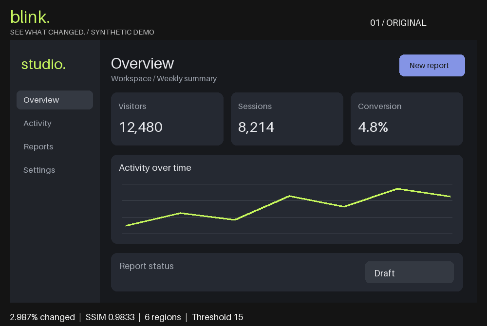
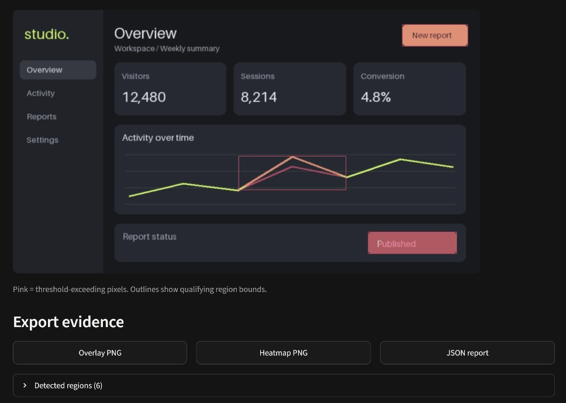

<p align="center">
  
</p>

# Blink

**See what changed.** A local-first visual comparison toolkit for developers, designers and QA engineers. Compare two images, locate changes, measure structural similarity and export reproducible evidence — through a visual workspace, CLI or Python API.

[](https://github.com/danielguillaumont/blink/actions/workflows/ci.yml) [](https://www.python.org/) [](LICENSE)


## Blink 2.0 (in development)

Blink is becoming a self-hosted **payment page integrity monitor** for PCI DSS 6.4.3 and 11.6.1
(see [`BUILD_PLAN.md`](BUILD_PLAN.md) and [`docs/progress.md`](docs/progress.md)). Available so far:

```bash
python -m pip install -e ".[capture,server]" && python -m playwright install chromium
blink lab &                      # local demo shop on 127.0.0.1:8780 (docs/lab.md)
blink init --lab                 # blink.yaml for the lab checkout (docs/configuration.md)
blink capture lab-checkout       # deterministic snapshot bundle under .blink/
blink baseline lab-checkout      # record the known-good baseline
blink lab --scenario overlay_form_added
blink scan --fail-on high        # findings with severity and "why it matters"; exit 1 on high+
blink inventory --sync           # PCI DSS 6.4.3 script inventory in blink.inventory.yaml
blink approve SCRIPT_ID --justification "..." --owner web-team
blink suggest-csp lab-checkout   # minimal CSP + SRI from the approved inventory
```

Detectors, rules and the findings JSON schema are documented in [`docs/detectors.md`](docs/detectors.md);
the inventory, approvals and static JS risk score in [`docs/inventory.md`](docs/inventory.md).

`blink compare` keeps its 1.0 behaviour, pinned by a byte-for-byte golden test.

## What Blink does

- Measure thresholded pixel differences with vectorized NumPy operations.
- Calculate structural similarity (SSIM) and locate connected change regions.
- Inspect differences through overlays, split, manual Blink, heatmap and side-by-side views.
- Export native-resolution PNG evidence and versioned JSON reports.
- Enforce visual regression limits in CI with predictable exit codes.



*Engine-rendered demonstration using a synthetic dashboard. No personal data.*

## Quick start

Python 3.11+ (3.12 recommended). From a terminal with Python available:

```bash
git clone https://github.com/danielguillaumont/blink.git
cd blink
python -m venv .venv
```

Activate the environment: `.\.venv\Scripts\Activate.ps1` on Windows PowerShell or `source .venv/bin/activate` on macOS/Linux. Alternatively, invoke the virtual environment's Python executable directly.

### Visual workspace

```bash
python -m pip install ".[ui]"
python -m streamlit run app.py
```

Open the loopback URL printed by Streamlit. Explore the built-in demo or upload two equal-sized images. Adjust the threshold and region filter, inspect changes and export evidence. Run from the repository root so the bundled loopback-only and telemetry settings are applied.



### Command line

```bash
python -m pip install .
python examples/scientific_smoke.py
blink compare outputs/bl02/before.png outputs/bl02/after.png --fail-above 2
blink compare outputs/bl02/before.png outputs/bl02/after.png --output-dir evidence
blink compare outputs/bl02/before.png outputs/bl02/after.png --json
```

The smoke fixture contains exactly 300 changed pixels out of 16,000 (1.875%). The first comparison passes the 2% quality gate; a 1% gate would fail. The output directory must not exist. Blink writes `overlay.png`, `heatmap.png` and `report.json` before evaluating the gate. If an I/O error leaves partial evidence, retry in a new directory.

| Exit code | Meaning |
| --- | --- |
| `0` | Comparison succeeded; optional quality gate passed |
| `1` | Comparison succeeded; changed percentage exceeded the limit |
| `2` | Invalid arguments, unsupported input or evidence I/O error |

The quality gate uses the unrounded percentage and fails only when strictly greater than the limit. With `--json`, reports go to stdout and errors or gate messages to stderr. Use `python -m blink_visual` if the `blink` executable is not on your PATH. Run `blink compare --help` for all options.

### Python API

```python
from blink_visual import analyze, difference_overlay, heatmap, load_rgb

result = analyze("before.png", "after.png", threshold=15)
print(result.pixels.changed_percentage, result.ssim)
print(result.to_dict())
difference_overlay(load_rgb("after.png"), result).save("overlay.png")
heatmap(result).save("heatmap.png")
```

The core package has no Streamlit dependency. A wheel from GitHub Releases can also be installed with `python -m pip install <wheel-file>` for CLI and library use; the visual workspace requires the source checkout and UI extra.

## How it works

| Component | Responsibility |
| --- | --- |
| NumPy | Widened integer subtraction, max-channel magnitude and boolean masks |
| SciPy | Eight-connected component detection and region geometry |
| scikit-image | Structural similarity across decoded RGB channels |
| Pillow | Image decoding, orientation, overlays and PNG rendering |
| Streamlit | Optional interactive local workspace |
| argparse | CLI and automation integration |

All three interfaces share the numerical engine. A pixel is changed when its maximum absolute RGB-channel difference is strictly greater than the threshold (0–255). CLI and workspace default to 15; the Python API defaults to 0. Region filtering changes the qualifying region count, not the changed-pixel percentage; the largest 100 qualifying regions are reported. SSIM uses a fixed data range of 255 and an odd window up to 7 pixels, and is unavailable if either dimension is below 3. SSIM and the fixed-scale heatmap are independent of the threshold.

### Input and privacy boundaries

Blink supports equal-sized, single-frame, opaque 8-bit RGB or grayscale PNG/JPEG images and honors EXIF orientation. It does not silently resize, align, composite transparency or convert color profiles. CLI and workspace inputs are capped at 20 MiB and 4 million pixels per image; those application limits do not apply to direct Python API calls. Images are processed locally; the core comparison engine makes no network requests. Workspace preview scaling never changes the analyzed or exported images.

## Development

```bash
python -m pip install -e ".[dev,ui]"
python -m pytest -q
python examples/smoke.py
python examples/scientific_smoke.py
python examples/generate_demo.py
```

CI runs the tests and smoke comparisons on Windows and Linux with Python 3.12. The optional UI extra is required for Streamlit tests. See [development checkpoints](docs/roadmap.md) for scope and [MIT license](LICENSE) for usage terms.
