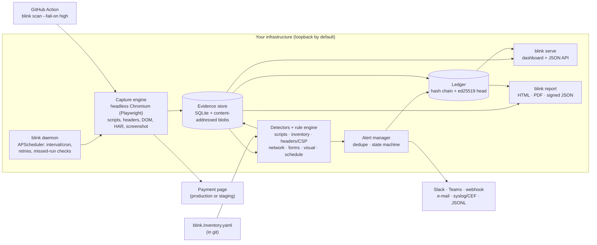
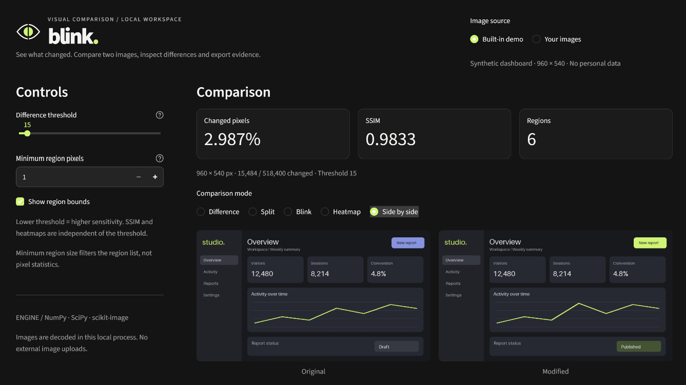

<p align="center">
  
</p>

# Blink

**See what changed on your payment page.** Blink is a self-hosted monitor for e-commerce
checkout pages. It loads the page the way a customer's browser does, inventories and hashes
every script, checks the security headers, the payment form and what the page looks like, and
alerts you when something changes. It also produces the signed evidence your PCI DSS assessor
asks for under requirements **6.4.3** (script management) and **11.6.1** (change and tamper
detection).

[](https://github.com/danielguillaumont/blink/actions/workflows/ci.yml) [](https://github.com/danielguillaumont/blink/actions/workflows/codeql.yml) [](https://www.python.org/) [](LICENSE)

## The problem

Web skimming (also called Magecart or formjacking) steals card numbers by slipping a few lines
of JavaScript into a checkout page. The script might come from a compromised tag manager, a
hijacked third-party library or a stolen CMS password. The page still works, and nothing looks
wrong. Server-side scanners do not see it, because it often lives only in the browser or in a
third-party file that changes after deploy.

PCI DSS v4.0 made this explicit. Merchants must keep an authorized, justified inventory of the
scripts on payment pages with an integrity check for each (6.4.3), and must detect
unauthorized changes to those scripts and to security-relevant headers at least weekly
(11.6.1). Blink does both, on infrastructure you control, and keeps a tamper-evident record of
having done so.

## 60-second demo

Requires Docker. Everything runs on `127.0.0.1`: a deliberately tamperable lab shop, the
scheduler and the dashboard.

```bash
git clone https://github.com/danielguillaumont/blink.git && cd blink
docker compose up -d --build --wait               # lab shop, daemon (scans every minute), dashboard
docker compose exec serve cat /data/.blink/blink.token   # copy the dashboard token
```

1. Open <http://127.0.0.1:8765>, paste the token and look at the clean **Targets** and
   **Inventory**.
2. Inject a third-party script into the lab checkout:

   ```bash
   docker compose exec lab blink lab --scenario new_third_party_script
   ```

3. Within a minute the daemon scans and **Alerts** shows a high-severity alert: a new
   cross-origin script without SRI, not in the inventory. Open it to see why it matters, the
   script, its static-analysis risk score and the screenshots, then acknowledge it.
4. `docker compose exec serve blink report --out /data/report` writes the signed audit
   report (HTML, PDF and `report.json`).

`docker compose down -v` removes everything. The same flow runs in CI on every change
(`scripts/demo_smoke.sh`).

## What it checks

| Detector | Finds | Requirement |
|---|---|---|
| Scripts and inventory | New, removed or changed scripts (external, inline, in frames); scripts not in the approved inventory; pinned-hash mismatches; static-analysis risk score (0–100) for skimmer patterns | 6.4.3, 11.6.1 |
| Headers and CSP | Removed or weakened `Content-Security-Policy` (`unsafe-inline`, wildcards), missing HSTS, framing and other security headers | 11.6.1 |
| Network | New destinations the page sends requests or beacons to | 11.6.1 |
| Payment form | Changed form `action`, new fields, hidden iframes, overlays | 11.6.1 |
| Visual | Pixel and structural changes in the payment region (the Blink 1.0 engine) | supporting |
| Schedule | Missed weekly evaluations and repeated capture failures | 11.6.1 |

Findings carry a severity and a "why it matters", are deduplicated into alerts (open →
acknowledged → resolved or accepted change) and can be sent to Slack, Teams, webhooks,
e-mail, syslog/CEF or JSONL. Every run, approval and decision is appended to a hash-chained,
ed25519-signed ledger.

## Architecture



## Install

```bash
pipx install "blink-checkout[capture,server]"
blink doctor                                           # prints the exact fix for anything missing
#   e.g. ".../blink-checkout/bin/python" -m playwright install chromium

blink init --url https://staging.example.com/checkout  # blink.yaml, ledger key, dashboard token
blink baseline                                         # record the known-good page
blink inventory --sync                                 # draft blink.inventory.yaml from what was seen
blink approve SCRIPT_ID --justification "Checkout UI" --owner web-team
blink scan --fail-on high                              # exit 1 on high or critical findings
blink daemon --metrics-port 9464                       # scheduled scans and alerts
blink serve                                            # dashboard on http://127.0.0.1:8765
blink report                                           # signed audit evidence
```

The PyPI distribution is `blink-checkout`; the command is `blink`. Until the first PyPI
upload, install a release wheel instead:
`pipx install "blink-checkout[capture,server] @ git+https://github.com/danielguillaumont/blink@v2.1.0"`.
Full documentation: <https://danielguillaumont.github.io/blink/>.

Or run the container image (`ghcr.io/danielguillaumont/blink:2`, non-root, read-only root
filesystem, state in `/data`):

```bash
docker run --rm --read-only --tmpfs /tmp --shm-size 256m -v blink-data:/data \
  ghcr.io/danielguillaumont/blink:2 scan --fail-on high
```

### In CI (GitHub Actions)

```yaml
- uses: danielguillaumont/blink@v2
  with:
    url: https://staging.example.com/checkout   # a site you own; or commit a blink.yaml
    fail-on: high
```

The action installs Blink and Chromium, records a baseline if none is cached, scans, uploads
`scan.json` and the signed report as an artifact, and fails the job on findings at or above
`fail-on`. See [`action.yml`](action.yml) for all inputs and
[`.github/workflows/action-sample.yml`](.github/workflows/action-sample.yml) for a working
example.

## Exit codes

| Code | Meaning |
|---|---|
| `0` | Clean, or the gate passed |
| `1` | Findings at or above `--fail-on` (or a failed ledger/report verification) |
| `2` | Usage, configuration or I/O error |
| `3` | Capture failed: target unreachable or timed out ([runbook](docs/runbooks/troubleshooting-capture.md)) |

## Honest limitations

- **One vantage point.** Blink sees what *its* browser receives. Skimmers that target only
  certain countries, devices, returning customers or times of day can be missed. Run it from
  where your customers are, and keep CSP and SRI as your preventive controls.
- **Detection, not prevention.** Blink tells you within your scan interval. A strict CSP
  (`blink suggest-csp` drafts one) and SRI block the attack in the first place.
- **Dynamic scripts are a judgment call.** Vendor scripts that change daily cannot be pinned.
  Blink reports their changes with a static-analysis score that a careful attacker can evade.
- **The ledger is tamper-evident, not tamper-proof.** Someone with both the signing key and
  write access to the store could rewrite history. Pin the public key elsewhere and keep the
  exported reports.
- **Evidence, not a verdict.** The report supports your assessor's judgment; it does not
  replace it ([PCI mapping](docs/pci-mapping.md)).
- Bot protection may challenge headless browsers. Allowlist Blink at the WAF rather than
  evading it ([runbook](docs/runbooks/troubleshooting-capture.md)).

## Documentation

The docs are published at <https://danielguillaumont.github.io/blink/>, with a sample signed
report generated from the lab on every build.

| Topic | Doc |
|---|---|
| Configuration (`blink.yaml`) | [docs/configuration.md](docs/configuration.md) |
| Detectors, rules, findings JSON schema | [docs/detectors.md](docs/detectors.md) |
| Script inventory, approvals, risk score, CSP suggestions | [docs/inventory.md](docs/inventory.md) |
| Daemon, alerts, sinks, ledger, metrics | [docs/operations.md](docs/operations.md) |
| Dashboard, API and its security model | [docs/dashboard.md](docs/dashboard.md) |
| Audit evidence report | [docs/report.md](docs/report.md) |
| PCI DSS 6.4.3 / 11.6.1 mapping | [docs/pci-mapping.md](docs/pci-mapping.md) |
| The lab and its tamper scenarios | [docs/lab.md](docs/lab.md) |
| Threat model | [docs/threat-model.md](docs/threat-model.md) |
| Runbooks: [an alert fired](docs/runbooks/alert-fired.md) · [rebaselining](docs/runbooks/rebaselining.md) · [capture failures](docs/runbooks/troubleshooting-capture.md) | docs/runbooks/ |
| Design decisions | [docs/adr/](docs/adr/) |
| Releasing, PyPI Trusted Publishing | [docs/releasing.md](docs/releasing.md) |

## Safety

Blink is a defensive tool. Its lab and test fixtures never read form values or send user
input anywhere; they only make detectable changes. The lab and dashboard bind to
`127.0.0.1` by default. Snapshots, logs and reports never store cookie values,
`Authorization` headers or other secrets. Only scan sites you own or are authorized to test.

## Blink 1.0: visual comparison (`blink compare`)

Blink started as a local-first image comparison toolkit, and it still is one. The engine now
also powers the visual detector, and `blink compare` keeps its 1.0 behaviour, pinned by a
byte-for-byte golden test.

```bash
python -m pip install .
blink compare before.png after.png --fail-above 2          # exit 1 if more than 2% changed
blink compare before.png after.png --output-dir evidence   # overlay.png, heatmap.png, report.json
blink compare before.png after.png --json
python -m pip install ".[ui]" && python -m streamlit run app.py   # the visual workspace
```

```python
from blink_visual import analyze, difference_overlay, heatmap, load_rgb

result = analyze("before.png", "after.png", threshold=15)
print(result.pixels.changed_percentage, result.ssim)
difference_overlay(load_rgb("after.png"), result).save("overlay.png")
```

A pixel counts as changed when its largest RGB-channel difference is greater than the
threshold (0–255; CLI default 15). SSIM and connected change regions are reported alongside.
Inputs are equal-sized PNG or JPEG images, processed locally, never resized. For `compare`,
exit code `1` means the changed percentage exceeded `--fail-above`.



## Development

```bash
python -m pip install -e ".[dev,ui,capture,server]"
python -m playwright install chromium
python scripts/fetch_js_corpus.py        # real-world JS corpus for the risk-score tests
ruff check . && ruff format --check .
mypy src/blink_visual --exclude 'src/blink_visual/(compare|analysis|render|workspace|cli)\.py'
pytest -q --cov=src/blink_visual
bandit -q -r src && pip-audit
```

Progress per phase is in [docs/progress.md](docs/progress.md). Licensed under [MIT](LICENSE).
